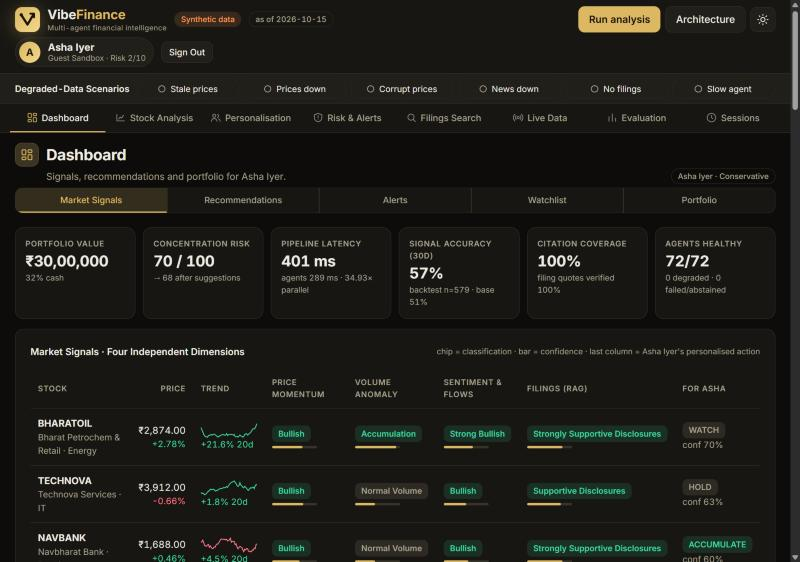
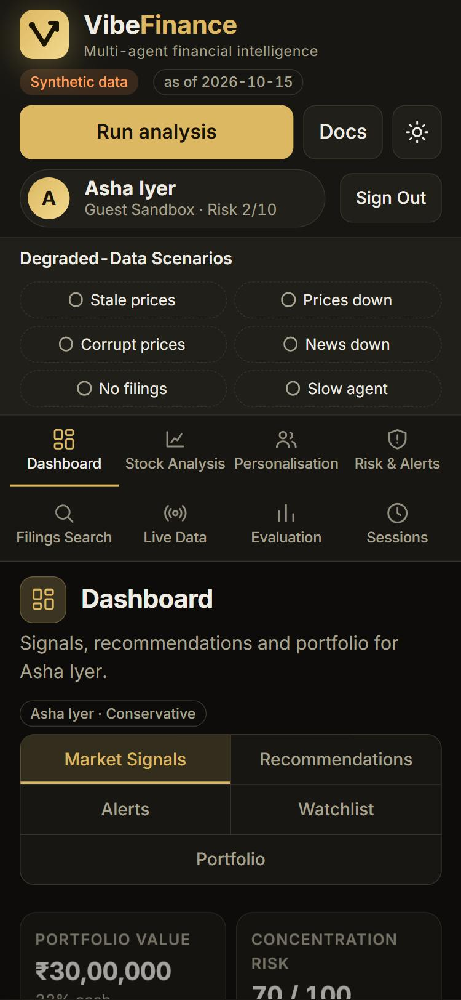
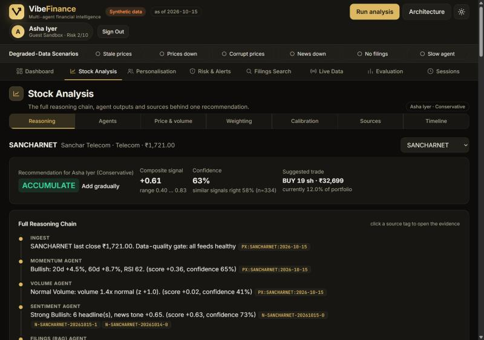
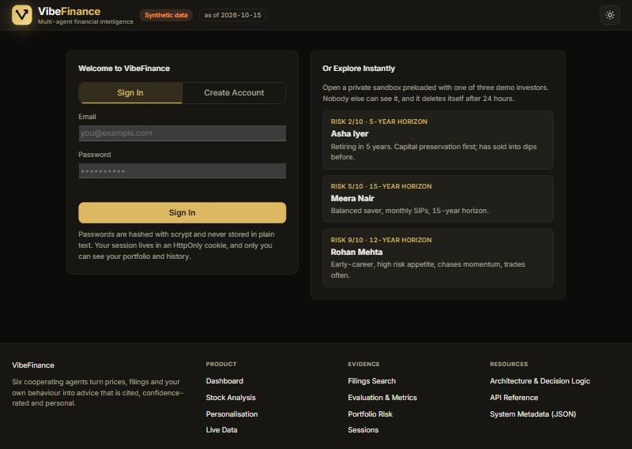

# VibeFinance

> Six cooperating AI agents turn market data, filings and your own trading habits into cited, confidence-rated, personalised investment guidance, built for retail investors in India.

[](https://vibefinance-c9a0.onrender.com/)
[](https://github.com/sahinurrahman-debug/VibeFinance)

<!-- TODO before submitting: replace YOUR_LIVE_URL (your Render URL) and YOUR_REPO_URL (your GitHub repo URL) above. -->

---

## Preview

| App Screenshot | Mobile |
|---|---|
|  |  |
|  |  |

---

## What It Does

Retail investors can see prices, headlines, filings and fund flows, but no tool weighs all of it against *their* risk limits and habits, shows its reasoning, and says how sure it is. VibeFinance runs
four market agents (price momentum, volume anomaly, sentiment and flows, and a filings agent that retrieves and quotes real passages) plus two personal agents (portfolio risk and behavioural traps) in parallel,
then merges them into one recommendation per stock. Every claim cites a source, every recommendation carries a calibrated confidence, and the same market data produces different advice for a cautious retiree and an aggressive trader.
It degrades gracefully when feeds fail or agents disagree, and measures itself on every run.

> **Data disclosure:** companies, prices, headlines, flows and filings are **synthetic** (fictional NSE-style tickers, seeded generator). Back-test numbers validate pipeline mechanics, not real-market performance. The *Live data* tab uses real public sources. Not investment advice.

---

## Features

- **Four independent signal dimensions**: momentum, volume anomaly, sentiment and flows, and filings, each with a label, confidence and cited evidence.
- **Retrieval-augmented analysis (RAG)**: hybrid BM25 + dense vectors in an embedded Qdrant database over 520 passages; every filing quote is verified against its source text.
- **Six agents in parallel** with a structured output contract, deadlines, failure isolation and a synthesis layer; conflicts between agents are explained, not averaged away.
- **Personalisation**: accounts store risk limits, portfolio, watchlist, alert rules and behavioural history; see the same stock analysed for you and three public demo personas side by side.
- **Portfolio risk and alerts**: risk contribution, stress tests, VaR, sector limits and per-user alert rules with new/cleared tracking.
- **Honest evaluation**: 30-day forward-return back-test, isotonic confidence calibration with uncertainty bands, a personalised strategy back-test, and latency benchmarks under load.
- **Live data mode**: Yahoo Finance prices, NSE announcements and Google News through the same agents.
- **Secure accounts**: scrypt-hashed passwords, HttpOnly session cookies, strict per-user data isolation, private guest sandboxes.
- **Graceful failure**: six injectable outages (stale/down/corrupt prices, news down, no filings, hung agent) and a uniform `{error}` API with friendly UI messages.

---

## Planning Docs

- [PRD](./docs/PRD.md)
- [Architecture](./docs/ARCHITECTURE.md)
- [API Spec](./docs/API_SPEC.md)
- [Roadmap](./docs/ROADMAP.md)

**Deviations from the plan:** the Next.js + Supabase example in the template is not used. The app is **FastAPI + vanilla JS + SQLite**, because the interesting work is the Python agent pipeline (NumPy, embedded Qdrant) and a single deployable service keeps it simple. Consequently authentication is implemented in-house
(email + password with scrypt and session cookies) instead of Google OAuth via Supabase; there is no email verification or password reset yet (see the Roadmap). Data is synthetic by design, with an optional live mode.

---

## Architecture

```
Browser (vanilla JS single-page app, cookie session)
 └── FastAPI  (app/server.py)  ── middleware: request id · Origin/CSRF check · security headers · error → {"error"}
      ├── /api/auth/*  /api/me/*         accounts, sessions, profile, portfolio  ── app/security.py (scrypt, token HMAC, rate limits)
      ├── /api/analyses  /api/comparisons  /api/strategy  /api/live
      │        └── Engine (app/engine.py)  parallel orchestrator (deadline per running task, failure isolation, request cache)
      │              ├── Momentum · Volume · Sentiment · Filings(RAG) agents   (market-wide, shared)
      │              ├── Risk · Behaviour agents                               (per user)
      │              └── Synthesis (weights → composite → conflicts → calibrated confidence → action → sizing → reasoning chain)
      ├── RAG: BM25 + LSA vectors ── Qdrant (embedded, persistent)           data: simulated NSE feed / live adapters
      └── SQLite (schema v2, foreign keys)                                   per-user rows only
```

A request to `POST /api/analyses` authenticates the cookie, loads *your* profile, portfolio and trade history, fans six agents out over a thread pool for 12 stocks (72 tasks, about 0.3 s with simulated feed latency),
validates each agent's output against the contract (uncited or malformed output is rejected), and synthesises a recommendation per stock using your weights and limits. The full result is stored under your account so later sessions can show what changed.

---

## Tech Stack

| Layer | Technology | Why |
|---|---|---|
| API | FastAPI + Uvicorn | Typed validation, async-ready, automatic OpenAPI in development |
| Compute | Python, NumPy | Signals, calibration, risk maths, back-tests |
| Retrieval | Embedded Qdrant + BM25 + LSA embeddings | Real vector DB with payload filters; no model download or API key |
| Database | SQLite (WAL, foreign keys) | Zero-ops relational store; single-process deployment |
| Auth | scrypt + server-side sessions in HttpOnly cookies | No third-party dependency; tokens stored only as HMACs |
| Frontend | Vanilla JS, CSS variables, inline SVG | No build step; fast; fully themeable (Graphite Gold, dark/light) |
| Deployment | Render (Blueprint) | `render.yaml`, health check, generated secret |
| Tests | pytest + FastAPI TestClient | 125 tests including auth, isolation and degraded modes |

---

## Database Schema

```sql
instruments     (symbol PK, name, sector)
users           (id PK, role member|guest|template, email UNIQUE, password_hash, name, age, risk_tolerance 1-10,
                 max_position_pct, max_sector_pct, max_volatility, horizon_years, cash, derived_from → users.id, created_at)
auth_sessions   (id PK, user_id → users.id CASCADE, token_hash UNIQUE, created_at, expires_at, user_agent)
holdings        (user_id → users.id, symbol → instruments.symbol, qty ≥ 0, avg_cost)           PK(user_id, symbol)
trades          (id PK, user_id → users.id, symbol → instruments.symbol, ts, side BUY|SELL, qty > 0, price > 0, note)
watchlist       (user_id → users.id, symbol → instruments.symbol)                              PK(user_id, symbol)
alert_rules     (user_id → users.id, key, value)                                               PK(user_id, key)
analysis_runs   (id PK, user_id → users.id, ts, degradations, metrics, summary)
recommendations (id PK, run_id → analysis_runs.id CASCADE, user_id → users.id, symbol → instruments, action, confidence, composite, payload JSON)
snapshots       (id PK, run_id → analysis_runs.id CASCADE, user_id → users.id, ts, payload JSON)
decisions       (id PK, user_id → users.id, rec_id → recommendations.id SET NULL, symbol → instruments, action, choice accepted|ignored|modified, ts, note)
```

Passwords are stored only as `scrypt$N$r$p$salt$hash`; CHECK constraints guarantee a member always has credentials and templates/guests never do. Deleting a user cascades to everything they own.

---

## API Routes

All errors are `{"error": "<message>"}`. Full reference with status codes: [docs/API_SPEC.md](./docs/API_SPEC.md).

| Method | Route | Auth | Description |
|---|---|---|---|
| POST | `/api/auth/register` | Public | Create account → 201 + session cookie |
| POST | `/api/auth/login` | Public | Sign in → 200 (401 generic, 429 after 5 failures) |
| POST | `/api/auth/guest` | Public | Private expiring sandbox cloned from a demo persona → 201 |
| POST | `/api/auth/logout` | Public | Destroy session → 204 |
| GET | `/api/me` | Required | Own profile, holdings, watchlist |
| PATCH | `/api/me` | Required | Update profile and risk limits |
| DELETE | `/api/me` | Required | Delete account and all data → 204 |
| PUT / DELETE | `/api/me/watchlist/{symbol}` | Required | Add / remove a watchlist stock → 204 |
| POST | `/api/me/trades` | Required | Paper trade → 201 (409 if not enough cash / shares) |
| POST | `/api/analyses` | Required | Run the six-agent pipeline → 201 + `Location` |
| GET | `/api/analyses/{id}` | Owner | A stored run (someone else's → 404) |
| DELETE | `/api/analyses/{id}` | Owner | Delete a stored run → 204 |
| GET | `/api/comparisons/{symbol}` | Required | You vs public demo personas, same market inputs |
| GET | `/api/live?tickers=` | Required | Same agents on live NSE data |
| GET | `/api/health` | Public | Liveness + DB check |

---

## Getting Started

```bash
git clone https://github.com/YOUR_USERNAME/YOUR_REPO
cd YOUR_REPO
pip install -r requirements.txt
cp .env.example .env        # optional for local development; every value has a safe default
python run.py               # http://127.0.0.1:8000  (--reset re-seeds the SQLite database)
python -m pytest -q         # 125 tests
```

Python 3.11+. Open the app, then either **create an account** or click a demo investor under *Explore Instantly* for a private sandbox. Simulated mode needs no API keys and no internet (seed 42, fully reproducible).

---

## Environment Variables

Real environment variables override `.env`. Templates: [`.env.example`](./.env.example) (development) and [`.env.production.example`](./.env.production.example). **No secret is committed**; development generates its own key into the git-ignored `data/` folder.

| Variable | Description | Where to get it |
|---|---|---|
| `VF_ENV` | `development` (default), `test` or `production` | You choose |
| `VF_SECRET_KEY` | Keys the session-token HMAC. **Required in production** (32+ chars); the server refuses to start without it | `python -c "import secrets; print(secrets.token_hex(32))"`; on Render it is generated for you |
| `VF_COOKIE_SECURE` | `Secure` flag on the session cookie (forced on in production) | `false` for http://localhost |
| `VF_ALLOWED_ORIGINS` | Extra browser origins allowed to call the API (same-origin always allowed) | Your public URL, only if you use a separate frontend |
| `VF_ENABLE_DOCS` | Serve Swagger UI at `/docs` (on in development, off in production) | |
| `VF_DB`, `VF_QDRANT`, `VF_DATA_DIR` | SQLite file, vector index folder, data folder | Defaults under `./data` |
| `VF_SESSION_DAYS`, `VF_GUEST_HOURS` | Session lifetimes (7 days / 24 hours) | |
| `VF_IO_SCALE`, `VF_AGENT_TIMEOUT`, `VF_WORKERS`, `VF_SEED`, `VF_VECTOR`, `VF_LOG_LEVEL` | Engine and logging tuning | See `.env.example` |

**Development vs production**: production enables Secure cookies, HSTS, same-origin enforcement, proxy-aware client IPs and hides the API docs, and fails fast on a missing secret. Development relaxes all of that so `http://localhost` just works.

---

## Auth Flow

- **Provider:** email + password (in-house). Passwords hashed with scrypt (per-user salt); minimum 10 characters with a letter and a number.
- **Sessions:** a random 256-bit token in an `HttpOnly`, `SameSite=Lax` (`Secure` in production) cookie. The database stores only an HMAC of the token, sessions expire (7 days; 24 hours for guests), and logout destroys the session server-side. Signing in replaces any existing session.
- **Protected routes:** every route that touches user data depends on `current_user` and uses only that user's id: no route accepts a user id, and another user's resource returns `404`. Unauthenticated calls get `401`; the UI then shows the sign-in screen.
- **Attack surface:** failed logins are rate-limited per IP and account (5 → 429); login errors are identical for unknown email and wrong password; cross-site writes (`Origin` mismatch) get `403`; responses carry CSP, `X-Frame-Options`, `nosniff`, `no-store`.
- **Guests:** "Explore Instantly" clones a demo persona into a private sandbox that nobody else can see and that expires after 24 hours.

---

## Full-Stack Checklist

| Area | How it is met | Proof |
|---|---|---|
| API design | Resource routes; GET/POST/PUT/PATCH/DELETE used for their meaning; 200/201/204/400/401/403/404/409/422/429 | [API_SPEC](./docs/API_SPEC.md), `tests/test_api_security.py` |
| Database schema | Normalised, foreign keys ON, CHECK constraints, cascades, no raw passwords | `app/store.py`, schema tests |
| Auth security | scrypt, HttpOnly cookies, hashed session tokens, protected routes, per-user isolation | isolation and cookie tests |
| Error handling | Every error is `{error: string}`, no stack traces (500s are generic and logged with a request id); UI shows toasts, inline form errors and retry cards | error-shape and 500 tests |
| Env management | `.env.example` + `.env.production.example`, secrets never in git, dev/prod profiles, fail-fast production validation | config tests, `render.yaml` |

---

## Deployment (Render)

1. Push to GitHub. 2. Render → **New + → Blueprint** → select the repo (uses [`render.yaml`](./render.yaml)). 3. Apply. Render generates `VF_SECRET_KEY`, builds, and health-checks `/api/health`.
Free-tier notes: the service sleeps after ~15 minutes, and the disk is ephemeral, so the SQLite database and vector index are rebuilt on every restart (demo personas return; **member accounts do not survive a restart** unless you attach a persistent disk and point `VF_DB`/`VF_QDRANT` at it).
NSE often blocks cloud IPs, so the *Live data* tab may show NSE as unavailable on Render (it degrades gracefully).

---

## Project Layout

```
app/server.py        REST API, auth plumbing, error handling, middleware
app/security.py      scrypt hashing, token HMAC, validation, rate limiter
app/config.py        env profiles, .env loader, fail-fast production validation
app/store.py         SQLite schema v2 and all per-user queries
app/engine.py        parallel orchestrator and pipeline         app/synthesis.py   personalised recommendation logic
app/agents.py        six agents                                 app/signals.py     pure signal functions
app/rag.py · vectorstore.py · corpus*.py   retrieval over a synthetic filing corpus (Qdrant)
app/backtest.py · calibration.py · strategy.py   evaluation        app/live.py   live data adapters
app/static/          single-page UI (index.html, logo.svg)       docs/   PRD, architecture, API spec, roadmap
tests/               125 tests                                    render.yaml · .env.example · .env.production.example
```

---

## What I Learned

**The hardest full-stack challenge was retrofitting trust into a system that already worked.** The first version of VibeFinance addressed investors by id in the URL, which is fine for a demo and a data leak in a product. Bolting a login screen on top would not have fixed that.
The real fix was structural: I removed user ids from the API entirely (`/api/me/...`), made the signed-in user the only identity any query can use, returned `404` for resources that belong to someone else so existence is not revealed, and then wrote tests that actively try to cross the boundary
(read another user's analysis, act on their recommendation, tamper with a role in a request body). Ownership is now a property of the code path, not a check someone has to remember to add.

**What building it taught me:**

- **Contracts make failure cheap.** Every agent must return a validated structure in which every claim cites a source; anything else is replaced by an explicit "no signal". That one rule is why a crashed agent, a timed-out feed and a missing filing all degrade the output instead of breaking the pipeline, and why verifying each quote against its source text was a ten-line addition rather than a redesign.
- **Report what the numbers actually say.** My first back-test looked far better than it should, because the simulated news partly anticipated returns. I weakened the simulator rather than keep the headline figure. Calibration then showed the confidence score adds little beyond the base rate, and the UI says so. Evaluation that flatters you is worse than none.
- **Concurrency bugs hide in the queue.** Timing agents out from the moment they were submitted caused false timeouts as soon as several analyses shared the thread pool. Measuring only the time a task is actually *running*, and caching shared feed calls with single-flight semantics, fixed it and was verified with load tests (1 to 8 concurrent users).
- **Real users find what fixtures never do.** The first account that held a single stock crashed the covariance step; a brand-new member with an empty portfolio exercised every empty state. Those paths only existed once real accounts did, which is the argument for testing through the public API rather than just the engine.
- **Security is a list of small decisions.** scrypt with per-user salts, storing only an HMAC of the session token, identical errors for unknown email and wrong password, rate limits, an `Origin` check on writes, one `{error}` shape, no stack traces, and a production profile that refuses to start without a secret. None is hard; skipping any one is how breaches happen.

**What I would architect differently.** I would design the account and ownership model first and the agents second, and settle one error format on day one instead of converging on it. For production scale I would move SQLite to Postgres, put sessions and rate limits in Redis so the service can run more than one instance,
and replace the corpus-trained LSA embeddings and simulated prices with a sentence-transformer and licensed market history, so that the accuracy figures describe real markets rather than the pipeline. The roadmap in `docs/ROADMAP.md` lays out that order of work.
